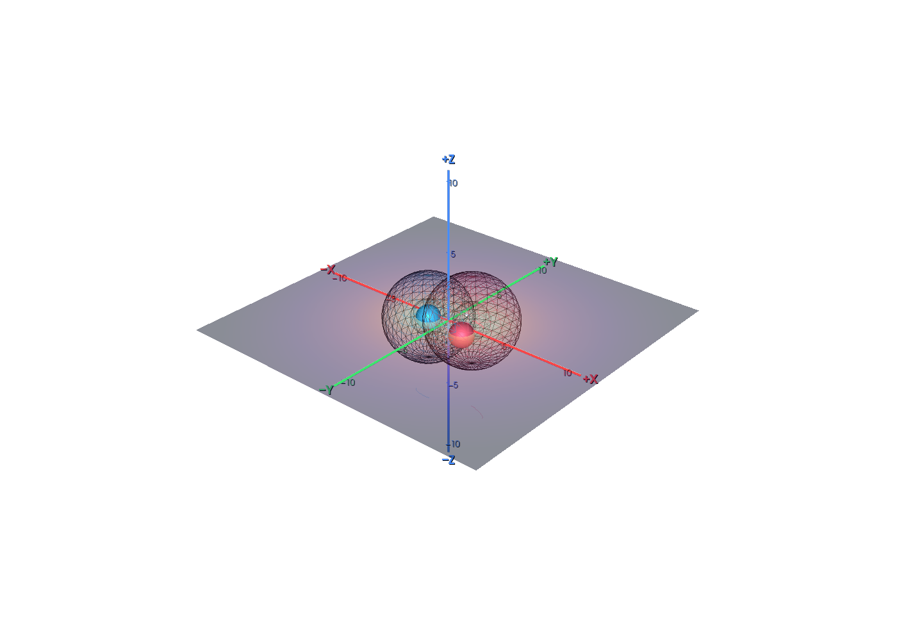
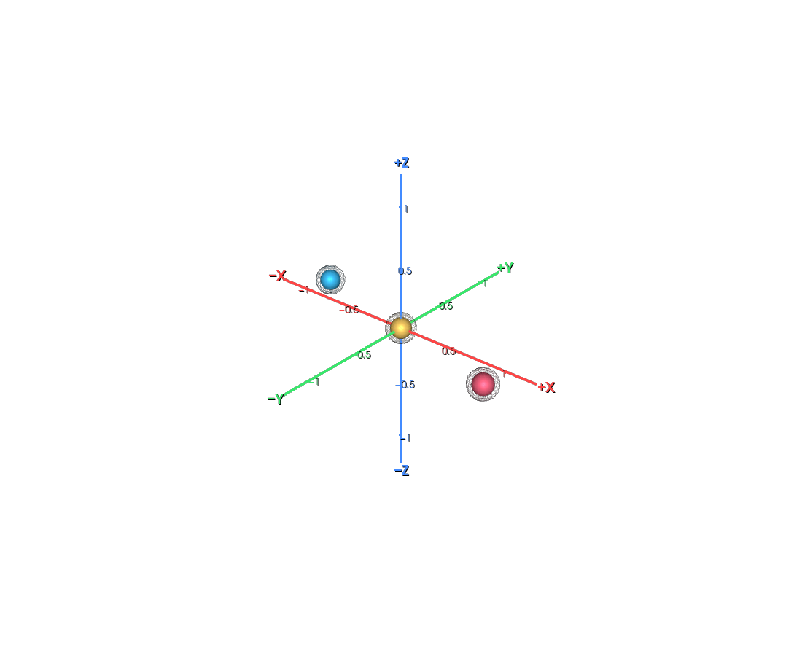
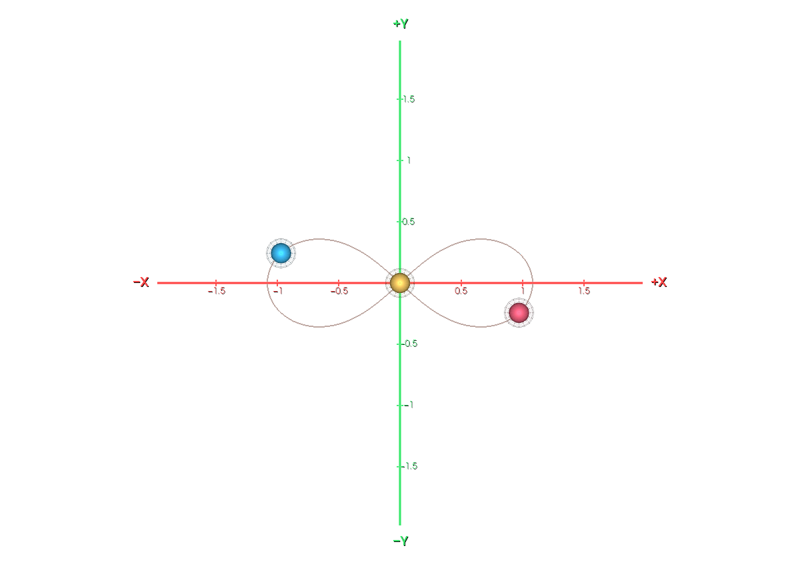
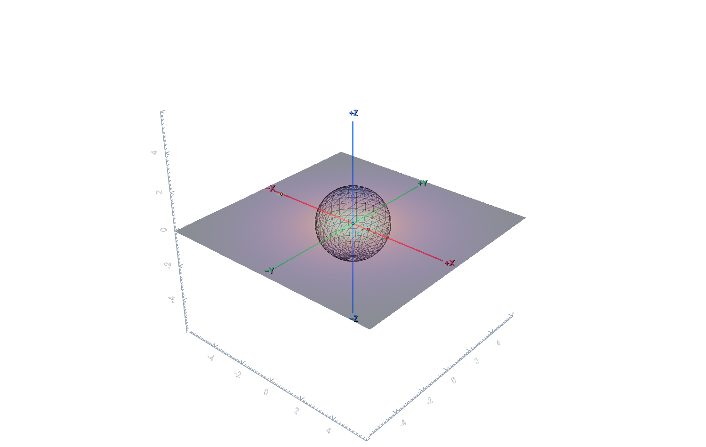
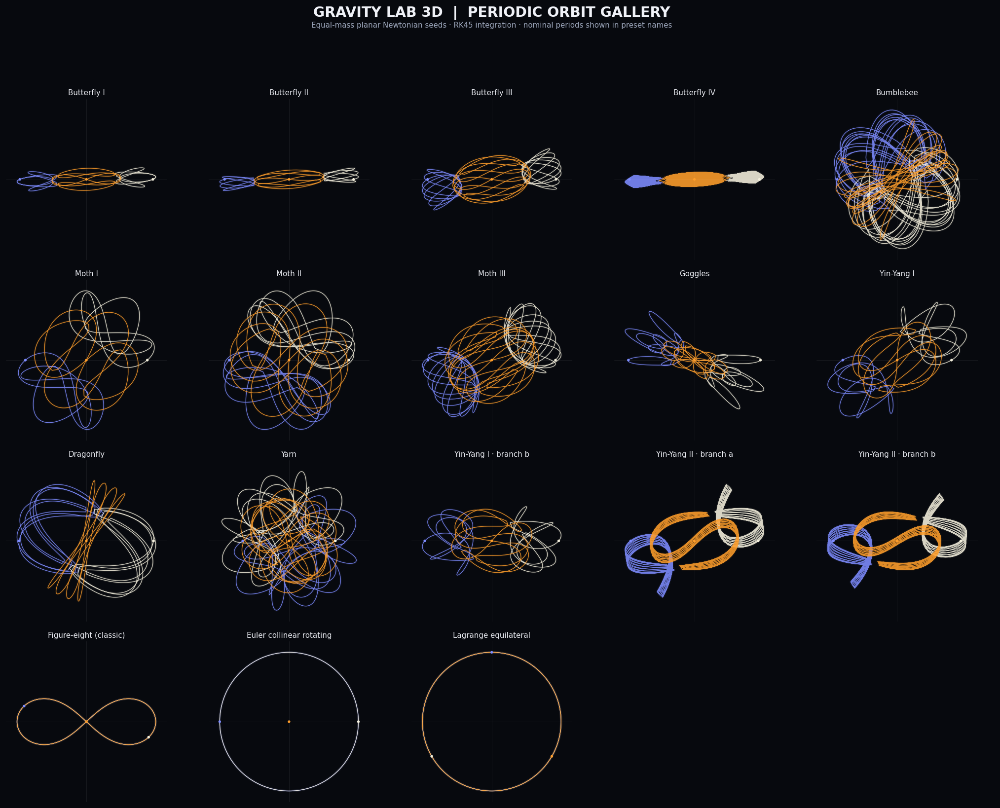

# Gravity Lab 3D

**An interactive 3D Newtonian three-body gravity simulator built with Python, NumPy, Tkinter, and VTK.**

Explore orbital motion, change the mass and physical radius of each body, inspect gravitational influence zones, and experiment with collisions in an interactive 3D scene. Gravity Lab 3D combines an editable simulation setup with field visualization and numerical diagnostics.


## Preview

### Interactive 3D scene

The scene shows the three bodies, gravitational influence shells, and a colored slice of the combined gravitational field.



### Coordinate axes

The X, Y, and Z axes are fixed in world coordinates, cross at the origin, and use red, green, and blue. Both positive and negative directions are labeled; numeric ticks appear on each side of zero. The viewport does not draw a second grey cube-edge axis frame.



### 2D trajectory view

Switch the GUI to **Settings → Visualizer mode → 2D view** for an orthographic top-down XY projection. The physics is still evolved in 3D.



### Astronomical preset

The project includes a Sun–Earth–Jupiter starting system using astronomical units, solar masses, and years.



### Periodic-orbit gallery

Select one of the equal-mass planar periodic-orbit presets to explore named families such as Butterfly, Moth, Bumblebee, Goggles, Dragonfly, Yarn, and Yin–Yang. The curves below are generated with this project's own integrator from the included initial-condition seeds.



## Features

- **Switchable 2D / 3D viewport** rendered with VTK. 2D gives an orthographic top-down XY view; 3D provides mouse-driven camera rotation and zoom. The simulation physics remains 3D in either view.
- **World-fixed RGB coordinate axes** that intersect at the world origin: X is red, Y is green, and Z is blue. Each axis has positive/negative end labels and numeric ticks on both sides of zero; a second grey cube-edge frame is deliberately omitted to avoid ambiguity.
- **Editable bodies:** mass, physical radius, 3D position `(x, y, z)`, and velocity `(vx, vy, vz)`. Rename each body and use **Customize Body** to open the system colour picker; the selected colour updates its sphere, influence shell, and trajectory.
- **Body-property calculations:** surface gravity, escape speed, and mean density.
- **Exact Newtonian gravity by default:** set softening `ε = 0` to use the inverse-square force outside physical contact. Optional non-zero Plummer softening is retained for numerical experiments and changes the force law.
- **Three numerical integrators:** Velocity Verlet (2nd order), Yoshida (4th-order symplectic for fixed steps), and error-controlled Dormand–Prince RK45.
- **Adaptive stepping:** encounter-aware time-step subdivision plus RK45 local-error control with editable relative and absolute tolerances.
- **Finite-radius collision modes:** merge, bounce with adjustable restitution, pass through, pause on impact, or a simplified two-remnant fragmentation model. Predicted contact times and swept-segment checks help prevent high-speed bodies from tunneling through each other. Fragmentation is an educational toy model, not a hydrodynamic impact solver.
- **Gravitational influence visualization:** acceleration-threshold shells and an approximate Eggleton Roche-lobe mode.
- **Combined gravitational-field map:** an XY slice of the total gravitational acceleration produced by the active bodies.
- **Visual aids:** trajectory trails, floor projections, acceleration-direction vectors, adjustable visual-size exaggeration, and camera fitting.
- **Thirteen themes:** Midnight Dark, Minimal Dark, Light Minimal, Dark, Light, Solarized Light, Ocean Blue, Purple Nebula, High Contrast, Graphite, Aurora, Solar Flare, and Cyberpunk. Neutral charcoal **Dark** is now the default; **Light** uses soft off-white surfaces and subtle borders.
- **Eighteen periodic-orbit presets:** Butterfly I–IV, Bumblebee, Moth I–III, Goggles, Dragonfly, Yarn, two Yin–Yang I branches, two Yin–Yang II branches, classic figure-eight, Euler collinear, and Lagrange equilateral.
- **Diagnostics:** energy drift, angular-momentum drift, linear-momentum drift, minimum separation, pair-separation plots, an energy-drift plot, and RK45 accepted/rejected-step statistics.
- **Validation tools:** GUI button to run numerical checks, plus tests for inverse-square gravity, collision tunneling, orbit closure, step-size convergence, RK45 tolerance convergence, conservation laws, and collision bookkeeping.
- **Exports:** PNG snapshots and CSV simulation history.
- **Astronomical preset** with AU, solar-mass, and year units and selected SI conversions for body properties.
- **JPL Horizons state-vector import** for a selectable trio of Solar System bodies and epoch. Vectors are fetched from the official Horizons API in the SSB-origin ecliptic frame, converted from AU/day to AU/year, and recentered to the selected trio's center-of-mass frame.
- **Optional REBOUND IAS15 comparison** to compare the built-in RK45 integrator against an independent N-body reference integrator for the same unsoftened, collision-free initial state.
- **Top menu bar:** File, Settings, and Help, in that order. Settings contains theme and 2D/3D view selectors plus advanced physics options; File contains JPL import, setup JSON load/save, PNG export, CSV history export, and REBOUND-report saving.
- **Windows high-DPI awareness** configured before Tkinter is imported.
- **Advanced physics options:** body spin and rotational energy/angular momentum, fixed-axis J2 oblateness, a pairwise weak-field first post-Newtonian (1PN) correction, radial tidal damping with an integrated heating proxy, and a simplified fragmentation collision mode.
- **Automated validation:** 41 built-in self-checks and pytest regression tests covering numerical convergence, conservation, collisions, advanced-model accounting, coordinate axes, and view modes.
- **Command-line snapshots** in either 2D or 3D view mode.

## Physics model and accuracy notes

- With `ε = 0`, the engine evaluates the unsoftened Newtonian inverse-square force. Physical radii do not alter the exterior field of spherical bodies; the collision handler prevents bodies from passing through contact in the usual collision modes.
- A non-zero `ε` adds Plummer softening to the denominator. This can make experiments with close approaches more numerically forgiving, but it is a modified force law and should not be described as exact Newtonian gravity.
- Collision time is estimated from relative position and velocity, followed by event-aware substeps and a swept-segment fallback. These are practical event-location safeguards, not a full analytic solution of the accelerated contact trajectory. For demanding close encounters, use RK45, tighten its tolerances, and verify convergence.
- **Yoshida** is the preferred option for efficient long integrations at a fixed time step. Variable/adaptive step sizes generally weaken the exact symplectic property. **RK45** is the error-controlled choice for reference runs and rapidly changing trajectories, although its performance depends on sensible tolerances and does not guarantee that every physical model is correct.
- Energy drift should be interpreted only for conservative motion. Merging and inelastic bouncing dissipate mechanical energy; momentum conservation and the collision energy budget are more useful checks during impacts.
- The built-in astronomical preset is an idealized three-body system, not a full ephemeris prediction. The JPL Horizons importer can load a specific epoch for three selectable bodies. After import, the app evolves only those three bodies, so omitted planets do not continue to perturb them; a drift away from a full Solar System ephemeris is expected. Vectors use Horizons' ecliptic reference plane with the Solar System barycenter as origin, and are translated to the selected trio's center-of-mass frame without changing relative state vectors. Optional advanced corrections now include a pairwise weak-field 1PN approximation, a radial tidal-damping/heat proxy, body spin bookkeeping, and a fixed-axis J2 exterior field. These are reduced models with explicit limitations—not a full relativistic or extended-body solver.

You can edit the **RK45 relative tolerance** and **RK45 absolute tolerance** fields in the GUI. Smaller tolerances generally increase computation and can improve integration accuracy; compare results rather than assuming that one tolerance fits every scale.

## JPL Horizons import and REBOUND comparison

Use **File → Import JPL Horizons states…** to select an epoch and three distinct supported bodies (Sun, Mercury, Venus, Earth, Mars, Jupiter, Saturn, Uranus, or Neptune). An internet connection is required. Body masses and radii are approximate catalogue values; Horizons supplies the state vectors. The imported system is then simulated as an isolated three-body problem, not as a complete ephemeris propagator.

Horizons API reference: [NASA/JPL Horizons API documentation](https://ssd-api.jpl.nasa.gov/doc/horizons.html).

For an independent reference calculation, install the optional package:

```bash
python -m pip install -r requirements-astro.txt
```

Then use **Help → Compare with REBOUND IAS15…**. The comparison is intentionally limited to an unsoftened Newtonian model with collision handling disabled and an initial state without overlapping bodies. It reports differences between two numerical integrators; this is not a comparison with measured positions or a full JPL ephemeris prediction. See the [REBOUND unit documentation](https://rebound.hanno-rein.de/ipython_examples/Units/) and [integrator documentation](https://rebound.hanno-rein.de/integrators/ias15/).

The top menu bar is ordered **File → Settings → Help**. Settings contains the theme selector, 2D/3D view selector, and advanced physics options. File includes JPL import, JSON setup save/load, PNG viewport export, CSV history export, and saving the latest REBOUND report.

## Requirements

- Python **3.10 or newer** is recommended.
- NumPy
- VTK 9.2 or newer
- Tkinter for the desktop GUI. Tkinter is included with many standard Python installations; on some Linux distributions it must be installed separately.

VTK is a relatively large dependency, so its first installation may take a little while. The 3D view is embedded in the main Tkinter window; it does not require the optional VTK Tcl/Tk bridge.

## Installation

### 1. Download the repository

Clone the repository, or download it from GitHub as a ZIP and extract it.

```bash
git clone <YOUR-REPOSITORY-URL>
cd <repository-folder-name>
```

Replace `<YOUR-REPOSITORY-URL>` with your GitHub repository URL and `<repository-folder-name>` with the folder created by `git clone`. If you downloaded a ZIP, open a terminal in the extracted `gravity_lab_3d` project folder instead.

### 2. Install dependencies

```bash
python -m pip install -r requirements.txt
```

### 3. Launch the application

```bash
python main.py
```

On Windows, you can also launch `run_gravity_lab.bat` from the project folder.

## Quick start

1. Launch the application. The **3D inclined triple (recommended)** preset is selected by default.
2. Rotate the 3D view by dragging with the mouse and zoom using the mouse wheel.
3. Choose any built-in preset, or select **Custom / Build your own** to preserve the currently displayed body values and edit them freely.
4. Click **＋ Build a new custom model** to populate a fresh three-body starter system. For each body, edit mass, radius, position `(x, y, z)`, and velocity `(vx, vy, vz)`.
5. Click **Apply values & reset** to validate your inputs and restart the simulation. Editing a body field automatically marks the setup as custom; choose a preset again to load its original initial conditions.
6. Choose a collision behavior and an influence-shell mode to explore different outcomes.
7. Select a theme from **Settings → Theme**. The theme is applied immediately.
8. Use **Play / Pause** to control the simulation, **Settings → Fit camera to system** to reframe the scene, and the **File** menu to save a PNG, export CSV history, or save/load a JSON setup. The fixed RGB axes pass through the world origin and show both negative and positive directions.

### Build a custom system

The model selector includes **Custom / Build your own**. Selecting it preserves the current values so you can adapt a preset without losing your edits. Use **＋ Build a new custom model** when you want to start from an example configuration. The model continues to use exactly three bodies; masses and radii must be positive, and all coordinates and velocity components must be finite numbers. Use **File → Save setup to JSON…** to store your initial conditions and settings, and **File → Load setup from JSON…** to restore them later.

### Keyboard shortcuts

| Shortcut | Action |
|---|---|
| `Space` | Play or pause the simulation |
| `R` | Apply values and reset (when a text field is not focused) |
| `2` | Switch to 2D XY view (when a text field is not focused) |
| `3` | Switch to 3D view (when a text field is not focused) |

## Presets

List available starting systems from the terminal:

```bash
python main.py --list-presets
```

Included presets include the original demonstration systems and an 18-model periodic-orbit gallery:

- 3D inclined triple (recommended)
- Binary + inclined small body
- Figure-eight, tilted 40 deg
- Pythagorean 3-4-5
- Lagrange triangle
- Hierarchical triple
- Sun - Earth - Jupiter (astronomical)
- Butterfly I, II, III and IV
- Bumblebee
- Moth I, II and III
- Goggles
- Dragonfly
- Yarn
- Yin–Yang I (two branches)
- Yin–Yang II (two branches)
- Classic planar figure-eight
- Euler rotating collinear configuration
- Lagrange rotating equilateral triangle

### Periodic-orbit seed notes

The equal-mass planar seeds use the canonical setup described by Šuvakov and Dmitrašinović: initial positions at `(-1, 0)`, `(1, 0)`, and `(0, 0)`, with bodies 1 and 2 sharing velocity `(pₓ, pᵧ)` and body 3 assigned `(-2pₓ, -2pᵧ)` to make total linear momentum zero. The original study presents numerical initial conditions for several named families of Newtonian three-body periodic orbits ([Physical Review Letters paper](https://doi.org/10.1103/PhysRevLett.110.114301), [arXiv version](https://arxiv.org/abs/1303.0181)). This project includes selected seeds and branches for visualization; the classic figure-eight uses its own published initial-state form. See [`docs/periodic-orbit-seeds.md`](docs/periodic-orbit-seeds.md) for the included seed values. Some seeds are rounded; the nominal period shown in a preset name is a reference value, not a guarantee that a finite-precision integration will close exactly. For quantitative work, compare the final state after one nominal period against the initial state, tighten RK45 tolerances, and verify convergence.

These presets are initial conditions for experimentation, not a guarantee that every system is stable indefinitely. Three-body dynamics can be chaotic and small numerical differences may lead to large changes over time.

## Run the physics checks

Run the built-in numerical self-test suite (currently 41 checks):

```bash
python main.py --selftest
```

The suite includes J2 force/potential consistency and momentum balance, weak-field 1PN momentum balance, tidal heat accounting, spin energy/angular momentum bookkeeping, and fragmentation mass/momentum checks, in addition to the Newtonian and periodic-orbit checks. You can also click **Run physics validation…** in the GUI to display the test report without closing the simulation.

Run the pytest regression tests:

```bash
python -m pip install pytest
python -m pytest -q
```

## Render a PNG from the command line

The application supports a headless snapshot mode that advances a preset to a chosen simulation time and saves a PNG. The renderer and your system's OpenGL setup must support offscreen rendering. Some Linux systems may need a virtual display such as Xvfb.

```bash
python main.py --snapshot preview.png \
  --preset "3D inclined triple (recommended)" \
  --time 3
```

Render the astronomical preset in 2D with another theme:

```bash
python main.py --snapshot solar-2d.png \
  --preset "Sun - Earth - Jupiter (astronomical)" \
  --time 2 \
  --theme "Light" \
  --view-mode 2D
```

Use `--view-mode 3D` for a 3D camera. You can customize the image dimensions with `--width` and `--height`. See all command-line options with:

```bash
python main.py --help
```

## Project structure

```text
gravity_lab_3d/
├── main.py                    # GUI entry point and command-line options
├── requirements.txt           # Core Python dependencies
├── requirements-astro.txt     # Optional REBOUND reference comparator
├── run_gravity_lab.bat        # Windows launcher
├── gravity_lab/
│   ├── physics.py              # Three-body integration and collision logic
│   ├── ephemeris.py            # JPL Horizons state-vector import
│   ├── rebound_compare.py      # Optional REBOUND IAS15 comparison
│   ├── fields.py               # Gravitational-field calculations
│   ├── presets.py              # Initial conditions and unit presets
│   ├── renderer_vtk.py         # VTK scene, geometry, camera, and snapshots
│   ├── gui.py                  # Tkinter interface and simulation controls
│   ├── themes.py               # Theme palettes
│   └── selftest.py             # Numerical self-test suite
├── tests/
│   ├── test_physics.py
│   ├── test_ephemeris.py
│   ├── test_renderer_axes.py
│   ├── test_periodic_gallery.py
│   └── test_rebound_compare.py
└── docs/
    ├── images/                 # App, axis, and orbit-gallery previews
    ├── periodic-orbit-seeds.md # Initial conditions and literature references
    ├── physics-foundation-update.md
    └── advanced-physics-models.md
```

## Physics model and limitations

See [`docs/advanced-physics-models.md`](docs/advanced-physics-models.md) for the scope, assumptions, and limitations of spin, J2 oblateness, 1PN, tides, and fragmentation.

Gravity Lab 3D is designed for interactive exploration and numerical experimentation. Keep these assumptions in mind when interpreting results:

- **Gravity model:** by default, presets use exact Newtonian point-mass forces with `ε = 0`. A non-zero Plummer softening value is an optional modified force model and should be documented when comparing scientific results.
- **Exterior versus interior gravity:** finite-radius spheres have the point-mass exterior field while bodies do not overlap, but their internal density profiles are not modeled. Collision handling approximates contact events; it does not solve deformable-body dynamics.
- **Collision modes:** merge, bounce, and fragmentation are simplified idealizations. They do not include deformation, material strength, shock physics, or full hydrodynamic effects. The collision-time estimate is refined by substeps and a swept-path fallback but is not an exact analytic trajectory-event solution for strongly accelerated paths.
- **Integrator trade-offs:** Yoshida is best used with a fixed step for long conservative orbits. Variable steps generally weaken strict symplecticity. RK45 adapts its internal step size to the local error estimate; tight tolerances cost more computation and still require convergence checks.
- **Influence shells:** a threshold shell shows where one body's isolated acceleration reaches a chosen value. It is a visualization threshold, not a finite edge to gravity.
- **Roche-lobe visualization:** the Eggleton expression is a two-body approximation. Its use in a changing three-body system is indicative, not an exact three-body equipotential calculation.
- **J2 oblateness:** the optional zonal-harmonic correction is an exterior-field model with fixed spin axes. Translational reaction forces are included for momentum balance, but torque-driven spin-axis precession and self-consistent shape evolution are not modeled. Do not use the correction inside a body's physical radius.
- **Spin:** rotational energy and angular momentum use a uniform-sphere moment of inertia, `I = 2/5 MR²`. Spin markers are visual indicators; the model does not integrate rigid-body torque or precession.
- **Tidal damping:** the optional model damps pairwise relative radial velocity and integrates the dissipated energy as a heat proxy. It is not a full equilibrium tide model and does not calculate Love numbers, tidal bulges, or spin synchronization. Use RK45 for this velocity-dependent model.
- **Relativistic correction:** optional 1PN dynamics use a pairwise weak-field approximation, not the full Einstein–Infeld–Hoffmann N-body equations. The usual Newtonian energy readout omits the 1PN Hamiltonian, and this is not suitable for strong-field compact-object simulations. Use RK45 and check the weak-field regime.
- **Fragmentation:** the two-remnant mode is a simplified educational collision response. It does not solve material strength, shock physics, hydrodynamics, or a debris-size distribution.
- **Astronomical preset:** Sun–Earth–Jupiter is an idealized three-body starting condition rather than a full ephemeris prediction. JPL-imported systems still evolve only the selected three bodies, so other planets no longer perturb them after import.
- **Visual-size exaggeration:** changing the displayed size of a sphere does not change its physical radius or the physics calculations.
- **Periodic-orbit presets:** these are initial-condition seeds for known equal-mass planar orbit families, not arbitrary decorative curves. Several values are rounded, and some families can be sensitive to tiny perturbations. Treat the displayed nominal period as a reference and check orbit closure and convergence before using results quantitatively.
- **Validation:** use the built-in tests and compare results across smaller time steps or tighter RK45 tolerances. Energy conservation is expected only for conservative motion; collisions can dissipate mechanical energy.

## Physics roadmap notes

The numerical foundation and collision-event limitations are documented in [`docs/physics-foundation-update.md`](docs/physics-foundation-update.md). The optional advanced physics models are detailed in [`docs/advanced-physics-models.md`](docs/advanced-physics-models.md). The periodic seed catalog and its literature references are in [`docs/periodic-orbit-seeds.md`](docs/periodic-orbit-seeds.md).

## Contributing

Bug reports, ideas, and pull requests are welcome. For a useful bug report, include your operating system, Python and VTK versions, the preset and settings used, and the relevant terminal output.

## License

A license has not yet been selected for this repository. Add a `LICENSE` file before publishing if you want to specify the terms under which others may use, modify, or redistribute the code.
